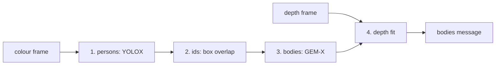

# How the node works

This page describes the four steps that xblick-gem-x executes per frame, the bodies message, all options, the
setup and the tests.

## The steps per frame



The node reads each camera through `xblick.rgbd`. This module pairs a colour frame with a depth frame by their
stamps. It scales the colour frame to the resolution of the depth frame and removes the lens distortion.

### 1. Persons

YOLOX-X finds the persons in the colour frame. The model is OpenMMLab's HumanArt ONNX model, which is the detector
that GEM-X itself uses. It executes on ONNX Runtime, a library that executes models in the ONNX format, in its CUDA
build.

The node keeps a person when the score exceeds `--min-score` and the box is at least `--min-height` pixels high. If
more than `--max-persons` remain, the node keeps the persons with the largest boxes.

### 2. Ids

`tracking.py` gives each person an id. It compares the boxes of the frame with the boxes of the persons it already
knows. The measure is the overlap of two boxes (intersection over union). The tracker assigns the pairs with the
largest overlap first, and a pair needs an overlap of at least 0.3.

A person without a match gets a new id. Ids count up from 1, as the body ids of the Azure Kinect do. An id ends when
its person has no match for more than 10 frames. The node never uses an id again.

### 3. Bodies

GEM-X's Body Pose model computes one body per person (`gemx.py`). The input of a person is a square crop around the
box. The side of the crop is 1.2 times the longer side of the box. All persons of a frame form one batch.

The model receives the intrinsics of the camera. It returns the 77 joints of SOMA and SOMA's mesh of 18,000 vertices
for each person, in metres in the camera frame. The model computes in bfloat16 by default.

### 4. Depth fit

GEM-X reconstructs a body from one image. It takes the size of a person from the body shape it has learned, and it
derives the distance from that size. The distance is therefore wrong for a person of unusual size, for example a
child or a crouching person.

The depth fit corrects the distance with the measured depth (`depth.py`). It moves the body along the ray from the
camera through the hips until the visible surface of the body lies on the measured depth. The size of the body stays
as GEM-X estimated it. The projection of the hips stays in place. The other joints move by a fraction of a pixel per
centimetre of shift at the usual distance of a body.

The fit works in three steps.

1. It projects the vertices of the mesh into the depth image and keeps the nearest vertex per pixel. This is the
   visible surface. The 18,000 vertices cover the pixels of a body densely enough at its usual size in a 640 x 480
   image, so the fit does not render triangles.
2. It computes the median of measured depth minus predicted depth over these pixels.
3. It repeats the median over the pixels within `--gate` (8 cm) of the first median. This step removes other people,
   objects in front of the person and the background behind the silhouette.

The fit needs at least 100 pixels with depth in step 1 and in step 3. With fewer pixels the body keeps the distance
of GEM-X, and `depth_fit` is null. `--no-depth-fit` switches the fit off for all bodies.

## The bodies message

The message is JSON with the encoding `application/json`. It has the layout of xblick-azure-kinect's bodies, so a
reader of that topic can read both. One reader is Durchblick's Rerun bridge. Change the layout only together
with its readers.

| Field | Content |
| --- | --- |
| `v` | 1, the version of the layout |
| `model` | `K4ABT_BODY_32` |
| `source` | `gem-x` |
| `stamp_ns` | the stamp of the frame |
| `frame_id` | the frame of the colour camera |
| `latency_ms` | the time from the stamp to the publication |
| `bodies` | a list with one entry per person |

| Field of a body | Content |
| --- | --- |
| `id` | the id of the person |
| `joints` | the 32 joints of the Azure Kinect by name. Each has `position_mm`, `orientation_wxyz` and `confidence`. |
| `soma77_mm` | all 77 SOMA joints in mm, in the order of `SOMA77` in `skeleton.py` |
| `depth_fit` | `shift_m`, `pixels`, `inliers` and `residual_m` of the depth fit, or null without a fit |

`shift_m` is the change of the depth along the camera's z axis. A positive value means that GEM-X placed the body
too near. `pixels` counts the visible pixels of the body that have a measured depth. `inliers` counts those within
the gate. `residual_m` is the median absolute difference of the inliers after the shift.

Each sample also has Durchblick's attachment with `seq` and `publish_ns`, so a reader knows the age of the bodies at
the time of sending. Durchblick's page on
[timestamps](https://github.com/xblick/xblick/blob/main/docs/concepts/timestamps.md) explains
the attachment.

### From 77 SOMA joints to 32 Kinect joints

`skeleton.py` maps the joints by anatomy.

| Kinect joint | SOMA joint |
| --- | --- |
| Pelvis, SpineNaval, SpineChest, Neck, Head | Hips, Spine1, Chest, Neck1, Head |
| EyeLeft, EyeRight | LeftEye, RightEye |
| Clavicle, Shoulder, Elbow, Wrist (left and right) | Shoulder, Arm, ForeArm, Hand |
| Hand, Handtip, Thumb (left and right) | HandMiddle1, HandMiddleEnd, HandThumbEnd |
| Hip, Knee, Ankle, Foot (left and right) | Leg, Shin, Foot, ToeBase |

SOMA has no nose and no ears. The node places the nose between the eyes and 4 cm ahead of them, away from the head
joint. It places each ear 7.5 cm out from the head joint along the axis of the eyes.

| Confidence | Meaning |
| --- | --- |
| 2 | a mapped joint. The Kinect SDK calls this level "medium". |
| 1 | nose and ears. The Kinect SDK calls this level "low, predicted". |
| 0 | GEM-X marks the projection of the joint as invalid. |

`orientation_wxyz` is always null, because the joint frames of SOMA differ from the joint frames of the Kinect SDK.

At start, `skeleton.check_soma77` compares the joint list with the rig file of SOMA 0.3.3. The node stops if they
differ.

## Options

| Option | Default | Meaning |
| --- | --- | --- |
| `--camera SPEC` | required | `CAMERA[:color=NAME][:depth=NAME]`. Repeat it for several cameras. |
| `--node NAME` | `gem_x` | the node's part of the topic and the name of its diagnostics status |
| `--bodies-key KEY` | `{camera}/{node}/bodies` | the topic of the bodies. The node fills in `{camera}` and `{node}`. |
| `--no-depth-fit` | off | publish the distance that GEM-X estimates from the image alone |
| `--autocast` | `bfloat16` | `bfloat16` or `none` (float32) for GEM-X |
| `--detector-device` | `cuda` | `cuda` or `cpu` for YOLOX |
| `--min-score` | 0.5 | the least score of a person. Live: it changes while the node runs. |
| `--min-height PX` | 60 | the least height of a person's box. Live: it changes while the node runs. |
| `--max-persons N` | 6 | the most persons per frame. Live: it changes while the node runs. |
| `--gate M` | 0.08 | the gate of the depth fit in metres. Live: it changes while the node runs. |
| `--max-offset-ms MS` | 20 | the largest stamp difference between a colour frame and its depth frame. A colour frame without a depth frame that close is skipped and counted. `0` accepts only equal stamps. |
| `--history N` | 10 | the number of frames that the node keeps per stream for the pairing |
| `--device` | `cuda` | the GPU of GEM-X and YOLOX: `cuda` is GPU 0, `cuda:N` is GPU N. A GPU that cannot be used ends the node with one line. |
| `--max-hz HZ` | 20 | the most colour frames per second. `0` or `none` means every frame. |
| `--local` | `auto` | `auto`, `shm` or `cuda`, see below |
| `--connect`, `--listen`, `--zenoh-mode`, `--config` | the router of this PC | Durchblick's session options |

**`--max-hz`.** A frame with two persons takes about 60 ms, so the default is 20. The limit applies to the colour
frames. The node decodes a depth frame only for a colour frame that it takes.

**`--max-offset-ms`.** The node pairs each colour frame with the nearest depth frame within this offset. The default
is a fixed 20 ms. It covers the cameras that we use: an Azure Kinect stamps the colour and the depth of one capture up
to 17 ms apart (with auto exposure), and the rc_visard gives a depth frame the stamp of its left image. A colour frame
whose own depth frame is missing is skipped and counted. It is not paired with a depth frame 33 ms or more away, which
is a neighbouring frame of a 30 Hz or 15 Hz camera.

**`--local`.** This option selects how frames of a camera on the same host reach the node. A *CUDA ring* is a ring
in GPU memory that the camera fills. A reader on the same GPU reads a frame from it without a copy to the CPU.
With `auto`, the node reads the CUDA ring when the ring is on the node's GPU (`--device`). Otherwise it reads the
host ring in shared memory. `shm` and `cuda` force one of the two. With `cuda`, the node stops when the camera
offers no CUDA ring. The start log and every report name the transport of each stream.

The node rejects a camera specification with a segmenter, a camera that appears twice and an invalid topic name.

## Setup

`tools/setup.sh` installs the code. The node downloads its weights ("Weights" below). It downloads nothing while
it works. We checked this with the network refused.

| Part | Source | How the version is fixed |
| --- | --- | --- |
| GEM-X's package `gem` | GitHub, NVlabs/GEM-X | a commit in `pyproject.toml` |
| GEM-X Body Pose weights (3.5 GB) | Hugging Face, `nvidia/GEM-X` | `GEMX_REVISION` in `gemx.py` |
| SOMA 0.3.3 body assets | Hugging Face, `nvidia/SOMA-X` | `SOMA_REVISION` in `gemx.py` |
| YOLOX-X HumanArt | OpenMMLab's archive | the archive's SHA-256 in `weights.py` |

Two CUDA versions work in one process. PyTorch uses CUDA 13. The CUDA build of ONNX Runtime brings CUDA 12 libraries
as `nvidia-*` wheels, and the node loads them before it creates the detector.

SOMA computes its mesh with Warp, which compiles GPU kernels at the first use and caches them. The node sets the
cache to `warp-cache` in the node's cache directory, `~/.cache/xblick/gem-x/warp-cache`.

## Weights

`weights.py` lists the files that the node reads. It takes the file names and revisions from `gemx.py` and adds the
YOLOX archive, its SHA-256, the exact sizes and the SHA-256 of each Hugging Face file. Those are the values that
Hugging Face states for the files at the fixed revisions (`lfs.oid`). For the two small JSON files they are the
hashes of the files at the revisions. All agree with copies that we downloaded earlier. The extracted
`yolox_humanart.onnx` has no SHA-256 of its own, because no source states one. The SHA-256 of its archive covers it. The node and `tools/setup.sh` use this one list. The download itself (lock, `.part` files, checks, progress) is the core's `xblick.weights`:
`weights.STORE` is the node's `xblick.weights.Store`. Its root is the node's cache directory, `~/.cache/xblick/gem-x/`
(`XBLICK_HOME`, `XDG_CACHE_HOME`, `--weights-dir`). The checkout's `weights/` is the former place: the node does not
read weights there, and it prints the command that moves them.

At its start, before it loads the models, the node checks that every file exists. When all files exist, the node
opens no network connection and writes no file, so it starts offline. When a file is missing, the node takes the
lock `~/.cache/xblick/gem-x/.download.lock`. It prints the models' terms, the files and their size, and it downloads each file.
The node writes a file as `<name>.part` in the same directory and renames it after the check. A file therefore has
its final name only when it is complete. A second node that starts at the same time waits for the lock. It then
finds the files and does not download them again.

The check compares the length of a download with the length that the server announced and with the size in
`weights.py`. Then it compares the SHA-256 of a Hugging Face file. A wrong size or SHA-256 keeps the download as
`<name>.part`, and the error names it. `--download-only` also checks the SHA-256 of files that exist. The YOLOX archive goes to `yolox_humanart.onnx.part.zip`, and the node checks its
SHA-256 before it takes `end2end.onnx` out of it. Then it removes the archive. A wrong SHA-256 keeps the archive,
and the error names it. Remove it, then start again. The progress is a line that updates in place on a terminal. In
a log file it is one line per tenth of the file.

A failure ends the node with one line that says what to do. Ctrl-C or SIGTERM during a download end the node at
once with the exit code 130 or 143. The node then removes the `.part` file and the archive.

`--download-only` downloads and checks the files, then ends. It needs no camera, no Zenoh router and no GPU.
`xblick.weights.parse_args` lifts the requirement of `--camera` when the command line contains `--download-only`.
`--no-download` ends the node when a file is missing and names the file. It is a read-only parameter like every
other start option. `--download-only` is a mode of the command line and has no parameter.

The download sends `HF_TOKEN`, or the token of `hf auth login`, to Hugging Face only. `HF_ENDPOINT` changes the
server, and `HF_HUB_OFFLINE=1` prevents the Hugging Face downloads.

## Tests

```bash
.venv/bin/python -m pytest tests
```

| File | Needs | What it checks |
| --- | --- | --- |
| `tests/test_helpers.py` | CPU | the overlap of boxes and the ids of the tracker, the skeleton mapping and its JSON, the SOMA joints against the rig, the depth fit. The fit finds a shift with a third of the surface occluded. |
| `tests/test_weights.py` | CPU, a local HTTP server | the files, their revisions and SHA-256, YOLOX out of its checked archive and a changed archive, a changed Hugging Face file refused, the node's `STORE`, `--download-only` and `--no-download`, a start that stops after its weights step without a GPU. The download itself: the core's tests |
| `tests/test_gemx.py` | a CUDA device and the weights in the cache directory | a body with the anatomy of a person, with the mapped joints where they belong. An empty image gives no person. |
